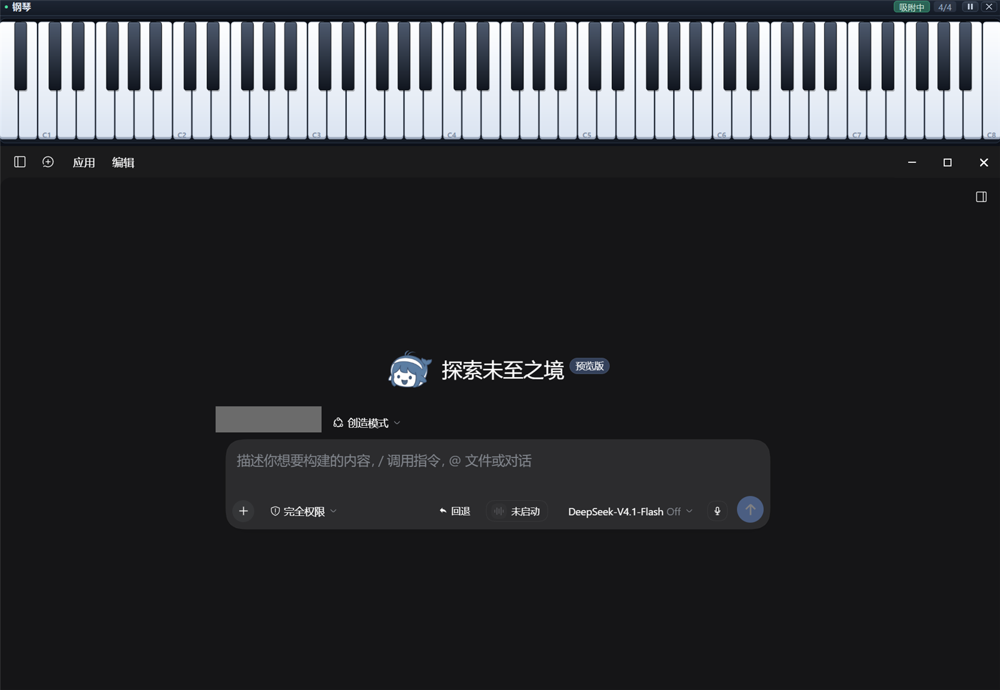

# 璇泽科技 · DSH 钢琴（dsh-piano）

一台标准 **88 键**电脑钢琴，挂载在 DeepSeek Harness 上。

**核心不是"能响"，是"能把一份乐谱变成一首歌"**：AI 写一份乐谱文本（或直接读一份
MIDI 文件）→ 插件解析成时间轴 → 按标准钢琴音色弹出来。谱就是歌，文件就是作品。



<sub>钢琴吸附在 DSH 窗口顶部，键位与主界面一体；右上角收着调号、拍号、速度、吸附开关。</sub>

---

## 快速开始（Windows）

**三步**，不需要装 Node、不需要编译：

```powershell
git clone https://github.com/XuanzeNetDev/dsh-piano.git
cd dsh-piano
.\install.ps1          # 链接到 DSH profile + 检查音源 + 编译缺失的 EXE
```

然后重启 DSH，在插件列表里启用「DSH 钢琴」。网页右下角出现「● 钢琴」胶囊。

### 30 秒验证它真的出声

不想看代码，只想确认它能不能响：

```
1. 装好后刷新页面
2. 右下角出现「● 钢琴」胶囊 → 点一下
3. 弹出独立窗口，键盘按 Z X C V B N M
4. 应该依次听到 C2 D2 E2 F2 G2 A2 B2
```

**听不到声音？** 看 `record/audio.log`，每一帧都会记一行：

```
11:02:19.461  音源 88 个采样
11:02:19.537  waveOut 打开成功，采样 88 个，每块 1024 帧
11:00:59.319  BLOCK 720  peak=0.4969  voices=5  bufs=3
                        ↑ 这个 peak 就是实际输出电平
```

`peak` 长期是 `0.0000` 表示没出声；`voices` 是当前同时发声的音数。
这两个数字能直接判断「引擎在跑但没数据」还是「数据有但没声音」。

**另一个验证方式**：让 AI 弹一段

```
piano_play("1 2 3 4 5")
```

终端会返回「弹 5 个音」，独立窗口应该跟着响。

### 依赖情况

**零外部依赖**：

| 需要 | 说明 |
|---|---|
| **Node.js** | DSH 自带，无需另装 |
| **.NET Framework 4.x** | Windows 10/11 自带，用于跑 `tools/PianoWindow.exe` |
| **Python 3** | **只有重新提取音源时**才需要；88 个 wav 已入库，正常使用不需要 |
| **npm 包** | **无**（`dependencies` 和 `devDependencies` 都是空，只用 `node:` 内置模块） |

### `install.ps1` 做了什么

1. 找到 `%USERPROFILE%\.dsh\profiles\desktop`
2. 把本仓库链接成 `node_modules\dsh-piano-xz`（用符号链接，改代码即时生效）
3. 检查 `assets/yup/wav/` 里是否 88 个 wav
4. 检查 `tools/PianoWindow.exe`，缺了就现场用 `csc.exe` 编译
5. 全部就绪后提示重启 DSH

### 如果 install.ps1 跑不了

手动两步：

```powershell
# 1. 链接
cmd /c mklink /D "%USERPROFILE%\.dsh\profiles\desktop\node_modules\dsh-piano-xz" "<本仓库路径>"

# 2. 编译播放器（如果 tools\PianoWindow.exe 不存在）
cd tools
C:\Windows\Microsoft.NET\Framework64\v4.0.30319\csc.exe /target:winexe /optimize+ `
  /out:PianoWindow.exe /r:System.Windows.Forms.dll /r:System.Drawing.dll /r:System.Web.Extensions.dll `
  PianoWindow.cs PianoAudio.cs
```

---
## 多乐器（GM 128 音色）

钢琴之外，可以换成任何 General MIDI 乐器 —— 小提琴、弦乐合奏、长笛、
尼龙弦吉他、小号、打击乐……**128 个音色，程序号就是 GM 标准编号**。

### 为什么 MIDI 天生支持多乐器

MIDI 规范里有一条 `Program Change` 事件（状态字节 `0xC0`），
一个字节就是音色号。同一份文件里，第 1 轨开头切成钢琴、第 2 轨切成弦乐，
播放时两条轨各发各的声 —— 这不是插件额外做的功能，是 MIDI 1991 年就定下的机制。

本插件把这个机制接了出来：`lib/midi.js` 解析 `0xC0`，
事件里带上 `pg`（音色号）和 `ch`（通道），窗口收到就切。

### 用起来是什么样

```
piano_instrument({ list: true })      # 列出 128 个音色
piano_instrument({ program: 40 })     # 切到小提琴
piano_instrument({ name: "弦乐" })     # 按名字模糊匹配
```

切完之后 `piano_play` / `piano_midi` 都用新音色。
一个 MIDI 文件里本来就换了音色的，会**自动跟着换**，不需要手动干预。

### 你选的乐器优先于 MIDI 文件

几乎所有 MIDI 文件在开头都发 `Program Change → 0`（钢琴）。
想在界面上选大提琴把这首钢琴曲拉一遍，不能被文件盖回去。

**默认规则（不需要任何配置）：**

| 你选的乐器 | 遇到文件里的 Program Change |
|---|---|
| 非钢琴（如 42 大提琴） | **忽略**，保持你选的 |
| 钢琴（program 0） | 跟随文件（多轨换音色才有意义） |
| 文件改成另一个非钢琴音色 | 照做（那是真实的换乐器，不是"切回钢琴"） |

日志会写明判断过程：

```
EVPROG 忽略文件里的 pg=0，保持 10（用户选的）
EVPROG -> 48 Strings（文件换乐器）
```

**想彻底锁死某个音色**（连文件里的换乐器都不理），用 `forceProgram`：

```json
{ "snapped": true, "program": 42, "bank": 0, "forceProgram": 42 }
```

启动日志会标 `[强制]`。注意它是**一次性的** —— 读完立刻从文件里删掉，
否则以后你用 `piano_instrument` 切任何音色都会失效。

### 循环长度校验

SF2 的采样靠 loop 点循环播放来维持长音。但循环段太短会有可闻的嗡鸣
（每秒重复几百次的固定频率，听起来像啸叫）。

导出时加了硬门槛：**循环段短于 64 个采样点（约 1.5ms）就退化为不循环**，
让包络自然衰减收尾。实测 128 个乐器里有 9 个（都在 Vibraphone）触发这条，
退化之后听感正常。

### 音源从哪来

用 **FluidR3Mono_GM.sf3**（22 MB，MIT 许可，已入库）。
它装着 128 个乐器的全部采样，但采样是 **Ogg Vorbis 压缩**的，
没法直接实时播（每次播放都要现场解压，延迟会毁掉）。

所以要**离线导一次**：

```bash
python tools/extract_gm.py
```

- 默认导出全部 128 个乐器，每个采样保留 4 秒，约 **2.5 GB**
- 只想要常用的几个：`python tools/extract_gm.py --only 0,40,48`（约 65 MB）
- 嫌大可以截短：`python tools/extract_gm.py --max-seconds 1.5`

导出的 WAV 在 `assets/gm/out/`，**不进版本库**（`.gitignore` 排除），
因为随时能从 sf3 重新生成。**导一次就够，之后不用再跑。**

### 音域与力度

GM 里一个乐器通常只有 10–164 个采样覆盖整个键盘，不像钢琴那样每键一个。
中间的音靠**变调**补：`rate = 2^((目标音高 - 采样原始音高)/12)`。
我们的插值用的是 8-tap Lanczos 带限重采样，不是线性插值，
所以变调时不会出现"格子卡住"的混叠声。

力度分层也是 GM 自带的：同一声部按 `velRange` 分成多层，
轻弹和重弹用的是不同采样，不是简单调音量。

### 变调基准：为什么不能信原始文件里的 root key

SF2 里"这个采样录在哪个音高"有两个来源：

| 位置 | 字段 | 说明 |
|---|---|---|
| `shdr` 采样头 | `originalPitch` | 采样自己写的 |
| `igen` 乐器层 | `overridingRootKey`（op 58） | **显式覆盖，优先级更高** |

**FluidR3Mono_GM.sf3 的 `shdr.originalPitch` 大面积是错的** —— 同一个乐器里
所有采样都写同一个值（长笛全写 72、口琴全写 60），跟实际录制音高差 10~12 个半音。

漏掉 `overridingRootKey` 的后果：

```
长笛采样实际录在 C#4(61)，shdr 却写 72
弹 C4(60)：
  错误：rate = 2^((60-72)/12) = 0.50   ← 降了一个八度，采样被拉长一倍
  正确：rate = 2^((60-61)/12) = 0.944  ← 几乎原速
```

听感就是**"调不对 + 刺耳"**：音低了一个八度，而且降调把共振峰全推歪了。

`tools/extract_gm.py` 现在按规范优先取 `overridingRootKey`，
索引里同时留了 `rawOriginalPitch` 便于排查。

### 循环

弦乐、风琴、合成铺底这些是**持续音**，采样只有 1–3 秒，
靠 sf2 自带的 loop 点循环播放，拉多长都不断。
钢琴、打击乐这类衰减音不循环，播完就结束。

---

## 三个"标准"

### 1. 键盘是标准钢琴

- 88 键，A0–C8，52 白键 + 36 黑键
- 白键等宽，黑键按真钢琴的比例压在键缝上：**C# 偏左、D# 偏右、F# 偏左、A# 偏右、G# 居中**
  （把黑键一律画在键缝正中间是"画着玩"，不是钢琴）
- 每个 C 标音名（C1…C8）；窗口宽度变化时**整排琴键等比伸缩**

### 2. 音是标准钢琴音

播放器用 **Yamaha Upright**（Polyphone / isamorphic.net，公有领域）的真实录音，
**88 键每键一个独立采样**，48 kHz 原始、提取时重采样到 44.1 kHz 单声道。

**每键独立采样的意义**：变调率恒为 `1.0`，也就是"读一个输出样本 = 读一个采样样本"。
不存在抽取、不存在插值、不存在混叠，所以低音区不会有那种"格子卡住"的阶梯感。

信号链（`tools/PianoAudio.cs`）：

| 环节 | 处理 |
|---|---|
| 重采样 | `rate = 1.0`，直接取整（不需要插值） |
| 防混叠 | 二级级联高通 90 Hz（12 dB/oct） |
| 琴槌噪声 | 低通 7–9 kHz（mdaPiano 压到 210 Hz 那种"闷"是另一个极端） |
| 直流 | 输出端 10 Hz DC blocker |
| 包络 | 8 ms 淡入 + 指数衰减 + 末尾 40 ms 线性淡出 |
| 复音 | 24 上限，超限偷最老的声部 |
| 输出 | winmm `waveOut`，1024 帧 × 3 块环形缓冲（约 70 ms 延迟） |

网页端另外带一套 **Salamander Grand Piano V3**（30 个采样点，CC BY 3.0），
用作浏览器内直接试听；采样没就绪时有物理建模合成兜底（16 次泛音各自衰减）。

### 3. 谱是标准简谱

照纸上那种简谱抄，双手分开写：

```
tempo 100
key 1=B3
unit 0.5
dyn 100

[RH]
3 2 6' 2' | 3 2 6' 2'

[LH]
4, 1, 4, 5, 6, r | 5, 2, 5, 6, 7, r
```

| 记号 | 含义 |
|---|---|
| `1`–`7` | 级数（可带 `#` / `b`） |
| `'` / `,` | 升 / 降八度（可叠） |
| `:n` | 占 n 拍 |
| `@v` | 单独给力度 |
| `+` | 同时按（和弦） |
| `-` | 延长一拍 |
| `r` / `0` | 休止 |
| `[RH]` / `[LH]` | 右手 / 左手声部 |
| `tempo` `key` `unit` `dyn` | 速度 / 调号 / 单记号拍数 / 默认力度（`ppp`…`fff` 或数字） |

MIDI 文件也直接支持（`piano_midi`），会读 tempo map、拍号、调号、分轨。

---

## 两个形态

```
┌─ DSH 网页 ─────────────────────┐
│  右下角「● 钢琴」胶囊            │
│  ├─ 点一下 → 弹出独立窗口       │
│  └─ 再点一下 → 关掉             │
└────────────────────────────────┘
              │ HTTP /events
              ▼
   PianoWindow.exe（独立置顶窗口）
   ├─ 88 键渲染 + 高亮
   ├─ waverOut 实时合成
   └─ 可吸附在 DSH 上方
```

**为什么需要独立窗口**：浏览器标签页切到后台或面板收起时，`requestAnimationFrame`
会被节流，音乐就断了。独立进程不受影响。

### 独立窗口

- **吸附按钮**（右上角）：默认关，钢琴可自由拖动；开启后**贴住 DSH 上方、
  置顶、锁定不可拖**，宽度跟随 DSH，状态存进 `settings.json` 持久化
- **暂停 / 继续**：冻结时间轴（`pauseOffset`），恢复后从原地继续，不跳
- **调号 `◀ 1=B(0) ▶`**：点箭头在 12 个调之间循环
- **拍号 / 速度**：可点，左键加、右键减

---

## 安装

```bash
# 从工作区链接到 profile
cd ~/.dsh/profiles/desktop
npm link F:/work/.../dsh-piano
```

或把整个 `dsh-piano` 目录复制到
`~/.dsh/profiles/desktop/node_modules/dsh-piano-xz`。

启用后在 DSH 插件列表里打开，网页右下角会出现「● 钢琴」胶囊。

### 编译独立窗口

`tools/PianoWindow.exe` **不入库**（二进制），从源码现场编译：

```powershell
cd tools
C:\Windows\Microsoft.NET\Framework64\v4.0.30319\csc.exe `
  /target:winexe /optimize+ /out:PianoWindow.exe `
  /r:System.Windows.Forms.dll /r:System.Drawing.dll /r:System.Web.Extensions.dll `
  PianoWindow.cs PianoAudio.cs
```

依赖 .NET Framework 4.x（Windows 自带，无需另装）。

### 还原音源

`assets/yup/*.sf2`（169 MB）超过 GitHub 单文件上限，**不进版本库**。

```
assets/yup/wav/          ← 88 个 .wav，已入库（22 MB），直接用
assets/yup/*.sf2         ← 需要时才下，用脚本提取
```

重新提取：

```bash
# 1. 下载 Yamaha Upright.sf2（约 170 MB）
#    https://isamorphic.net  →  或搜索 "Yamaha Upright soundfont Polyphone"

# 2. 提取 medium 层的 88 个键，重采样到 44100 单声道
python tools/extract-sf2.py
```

---

## 界面

标题栏右上角三个东西：

```
[● 钢琴]  [▼ 10 · Music Box]  [MIDI]
   ↑              ↑              ↑
  开关窗口      选乐器        导入 .mid 播放
```

### 乐器选择器

点开是一个可搜索的列表：

- **搜索**：打 `violin`、`弦乐`、或直接打编号 `48`
- **滚到哪记到哪**：下次打开停在同一位置（存 `localStorage`）
- **分类吸顶**：滚动时分类名固定在顶部
- **快捷键**：`Ctrl + ↑` / `Ctrl + ↓` 切上一个/下一个乐器

快捷键在聊天输入框里不生效（那儿的 `Ctrl+↑↓` 有别的用途），
点一下页面其他地方就能用。

### 导入 MIDI

点「MIDI」选一个 `.mid` 文件，会：

1. 上传给宿主解析
2. **自动把钢琴窗口拉起来**（如果没开）
3. 从第一个音开始就用**你当前选的乐器**

工具栏不会因为导入而抖动 —— 按钮宽度固定，结果只在失败时通过悬停提示显示。

## 导出

把当前队列里的曲子渲染成 WAV。**没有按钮，在对话里说一句就行**：

```
piano_export()                          → 时间戳命名
piano_export({ file: "我的曲子.wav" })   → 指定文件名
```

**离线渲染**，不走扬声器：

| | 实时播放 | 离线渲染 |
|---|---|---|
| 一首 4 分钟的歌 | 等 4 分钟 | **约 1 秒**（几百倍速） |
| 系统卡顿影响 | 会掉帧 | 不影响 |
| 结果确定性 | 每次略有不同 | **完全可复现** |

音色、包络、循环用的都是演奏时同一套代码（`MixVoice` 实时和离线共用），
所以导出的声音和你听到的一模一样。

输出在插件目录的 `record/` 下，默认 44100Hz 单声道 16bit。

要 MP3 的话把扩展名写成 `.mp3` 之后用 ffmpeg 转 —— 内置不直接生成 MP3
（别人的机器不一定装了 ffmpeg，写死路径会让插件在他们那儿失败）。

## 工具（Host 侧）

| 工具 | 作用 |
|---|---|
| `piano_score` | 把简谱文本写成 `.score` 文件并演奏 |
| `piano_play` | 直接弹一段简谱（不落盘） |
| `piano_midi` | 播放 `.mid` 文件（支持 `tempoScale` / `transpose` / 选轨） |
| `piano_piece` | 内置曲目（小星星、欢乐颂、致爱丽丝、卡农…） |
| `piano_stop` | 立刻静音 |
| `piano_status` | 队列状态、下一个音、键盘范围 |
| `piano_instrument` | 切换 GM 乐器（128 音色），可列出清单 |

HTTP 前缀：`/api/dsh-piano-xz`

---

## 目录结构

```
dsh-piano/
├── index.js               Host 侧：8 个工具 + HTTP 路由（1637 行）
├── client.js              浏览器侧：88 键渲染 + 乐器选择器（2110 行）
├── cordis.patch.yml       插件挂载点
├── package.json
├── icon.svg
├── install.ps1            Windows 一键安装
├── lib/
│   ├── notation.js        简谱解析（379 行）
│   ├── midi.js            MIDI 解析 + Program Change（360 行）
│   ├── engine.js          事件队列 / 调度 / 导出快照（249 行）
│   ├── notes.js           音名 ↔ MIDI（199 行）
│   └── score.js           谱面读写（131 行）
├── tools/
│   ├── PianoWindow.cs     独立窗口 WinForms（2157 行）
│   ├── PianoAudio.cs      waveOut 混音 + 离线渲染（869 行）
│   ├── GmEngine.cs        GM 多乐器引擎（375 行）
│   ├── sf2_parse.py       SF2/SF3 完整解析（352 行）
│   ├── extract_gm.py      GM 音源 → WAV 导出（301 行）
│   ├── verify_gm.mjs      128 音色覆盖检查（144 行）
│   ├── extract-sf2.py     Yamaha SoundFont → 88 个 wav（150 行）
│   └── PianoWindow.exe    预编译好的播放器
├── assets/
│   ├── piano/             Salamander mp3（网页试听用）
│   ├── yup/wav/           Yamaha 88 键采样（钢琴，EXE 发声用）
│   └── gm/
│       ├── FluidR3Mono_GM.sf3   GM 128 音色音源（22 MB，已入库）
│       └── out/                 导出的采样（gitignore，本地生成）
├── scores/                示例乐谱与 MIDI
├── locale/                zh / en
└── LICENSE
```

---

## 键盘映射（独立窗口）

主键盘四排 + 小键盘，覆盖 **C2–B7（6 个八度）**：

```
Z排   Z=C2  X=D2  C=E2  V=F2  B=G2  N=A2  M=B2
A排   A=C3  S=D3  D=E3  F=F3  G=G3  H=A3  J=B3
Q排   Q=C4  W=D4  E=E4  R=F4  T=G4  Y=A4  U=B4
1排   1=C5  2=D5  3=E5  4=F5  5=G5  6=A5  7=B5

Num1=C6  Num2=D6  Num3=E6  Num4=F6  Num5=G6  Num6=A6  Num7=B6
Num8=C7  Num9=D7  Num/ =E7  Num* =F7  Num- =G7  Num+ =A7  Num. =B7
```

黑键：**Shift + 该白键**（`Shift+Z` = C♯2）。

> 只在窗口有焦点时响应。不做全局钩子 —— 那会吞掉 `Q W E 2 3` 这些打字键。

---

## 致谢与音源许可

**音源**

| 音源 | 用途 | 许可 |
|---|---|---|
| Yamaha Upright（每键 88 采样） | 钢琴 | 见原作者声明 |
| **FluidR3Mono_GM.sf3** | **GM 128 音色** | **MIT** |
| Salamander Grand Piano V3 | 网页端钢琴兜底 | CC BY 3.0 |


| 资源 | 作者 / 来源 | 许可 |
|---|---|---|
| **Yamaha Upright** SoundFont | Polyphone / isamorphic.net | 公有领域 |
| **Salamander Grand Piano V3** | Alexander Holm | CC BY 3.0 |
| 简谱 / MIDI 解析、窗口、合成 | 璇泽科技 | 见 LICENSE |

---

## 变更记录

版本演进、修过哪些坑、怎么验证的，见 [CHANGELOG.md](CHANGELOG.md)。

## 许可

本项目采用 **双许可（dual licensing）**。

### 一、非商业使用 —— 免费

按 [PolyForm Noncommercial License 1.0.0](LICENSE) 授权：

- ✅ 个人学习、研究、爱好项目、个人创作
- ✅ 教学、非营利组织、公益使用
- ✅ 修改、分发（需保留本许可与版权声明）
- ❌ **任何有商业预期的使用**

### 二、商业使用 —— 需单独授权

以下用途需要事先取得书面授权：

- 企业或团队内部使用的商业工具
- 集成进对外销售的产品或服务
- 以 SaaS / 订阅 / 收费下载等形式提供
- 基于本项目提供付费咨询、定制、部署、托管
- 打包进硬件或商业发行版

**如何申请**：[在 GitHub 上提交商业授权咨询](https://github.com/XuanzeTech/dsh-piano/issues/new?template=commercial-license.md)

提交后会收到回复，说明用途、规模、分发方式后给出报价与条款。
也可以用仓库的 Issues 直接提问，不确定算不算商业的先问一句就行。

### 三、著作权归属

本项目著作权归 **璇泽科技** 所有。

著作权人及其控股、控制或受同一控制的公司/组织，不受上述非商业条款限制，
可自由将本项目用于任何商业目的。上述「非商业」条款约束的是与本项目
无关联的第三方。

### 四、不确定算不算商业？

先在 Issues 里问一句就行，不需要猜。学术、个人、开源项目反向贡献、
非营利用途，一般都会直接放行。

完整条款见 [LICENSE](LICENSE)，商业授权说明见 [COMMERCIAL.md](COMMERCIAL.md)。

> **为什么 GitHub 显示 `Other / NOASSERTION`？**
>
> 本项目用 PolyForm Noncommercial 1.0.0，它是一份标准开源协议，
> 但不在 GitHub 内置的 SPDX 识别列表里，所以许可证栏会显示成
> `Other`（SPDX: `NOASSERTION`）。
>
> 一句话版本：**个人免费用，商用需授权，著作权归璇泽科技。**
> 条款全文见 [LICENSE](LICENSE)，没有隐藏条款。
